# Booking Ruang Rapat · PT Pelindo Multi Terminal

Aplikasi web internal untuk melihat jadwal, mengajukan, dan menyetujui penggunaan ruang rapat di seluruh kantor/cabang PT Pelindo Multi Terminal. Pegawai mengajukan booking, PIC ruangan memutuskan pengajuan, Admin mengelola ruangan dan akun di cabangnya, dan Super Admin mengelola semua lokasi.

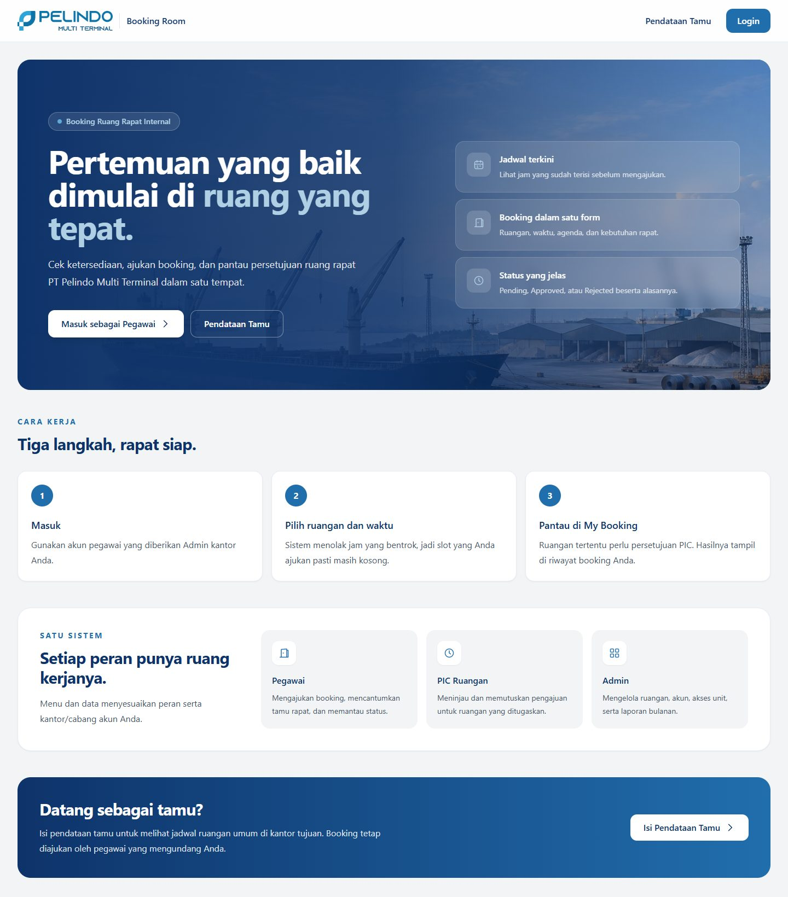

> **Status:** aktif dikembangkan. Notifikasi WhatsApp bersifat opsional dan memerlukan konfigurasi server tambahan (lihat [Konfigurasi opsional](#konfigurasi-opsional)).

## Daftar isi

- [Fitur utama](#fitur-utama)
- [Tangkapan layar](#tangkapan-layar)
- [Peran dan hak akses](#peran-dan-hak-akses)
- [Alur aplikasi](#alur-aplikasi)
- [Arsitektur](#arsitektur)
- [Keamanan](#keamanan)
- [Tech stack](#tech-stack)
- [Menjalankan secara lokal](#menjalankan-secara-lokal)
- [Pengujian](#pengujian)
- [Konfigurasi opsional](#konfigurasi-opsional)
- [Dokumentasi](#dokumentasi)

## Fitur utama

| Fitur | Ringkasan |
| --- | --- |
| **Jadwal ruangan** | Kalender bulanan dan jadwal harian per ruangan dengan status Menunggu PIC, Terjadwal, Sedang berlangsung, dan Sudah lewat. Semua waktu dalam WIB. |
| **Booking ruangan** | Katalog ruangan, lalu form booking (Livewire) untuk tanggal, jam, agenda, jumlah peserta, konsumsi, teknisi IT, dan nama tamu (opsional). Booking multi-tanggal dibuat sebagai pengajuan terpisah per tanggal. |
| **Validasi di server** | Setiap pengajuan diperiksa: izin pemohon, akses unit untuk ruangan *restricted*, status ruangan, jam yang sudah lewat, dan bentrok dengan booking Pending/Approved. Token pengajuan mencegah pengiriman ganda. |
| **Persetujuan (approval)** | Ruangan atau permintaan tambahan yang memerlukan persetujuan masuk ke antrean PIC/Admin. Keputusan disertai catatan, dan riwayat keputusan tersimpan. |
| **Dashboard per peran** | Pegawai melihat rapat mendatang dan status pengajuan. PIC melihat antrean approval dan jadwal hari ini. Admin melihat kondisi ruangan serta kelengkapan PIC dan fasilitas. |
| **Administrasi** | Kelola akun, unit organisasi, kantor/cabang, lantai, fasilitas, ruangan, PIC, dan akses unit. Master data global hanya untuk Super Admin. |
| **Laporan bulanan** | Rekap per bulan dan per ruangan, unduh CSV (aman dari *formula injection*), serta cetak/PDF dari browser. |
| **Pendataan tamu** | Tamu mengisi identitas di `/tamu` dan dapat melihat jadwal ruangan umum di kantor tujuan untuk waktu terbatas. Data dihapus otomatis setelah masa aktif. |
| **Notifikasi WhatsApp** | Opsional, melalui Fonnte: antrean pesan, template yang dapat diubah, dan retry dari halaman Admin. |

## Tangkapan layar

| Beranda (mobile) | Login | Pendataan tamu |
| --- | --- | --- |
| 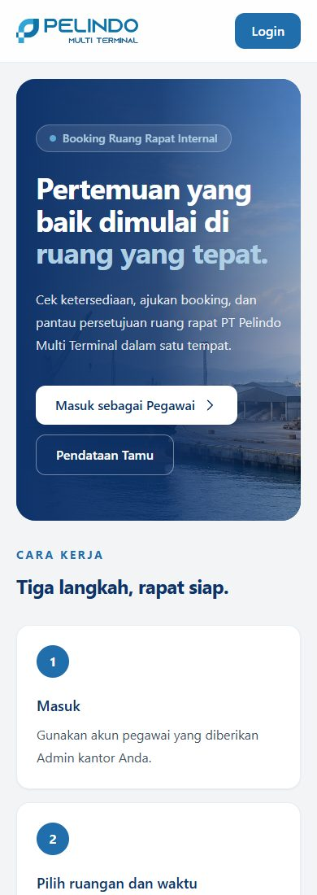 | 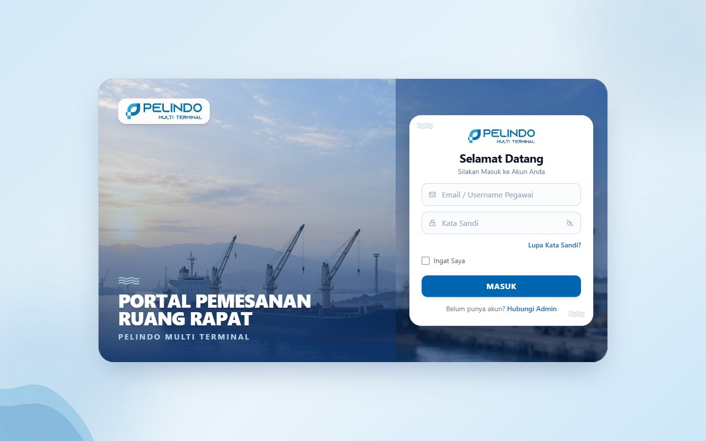 | 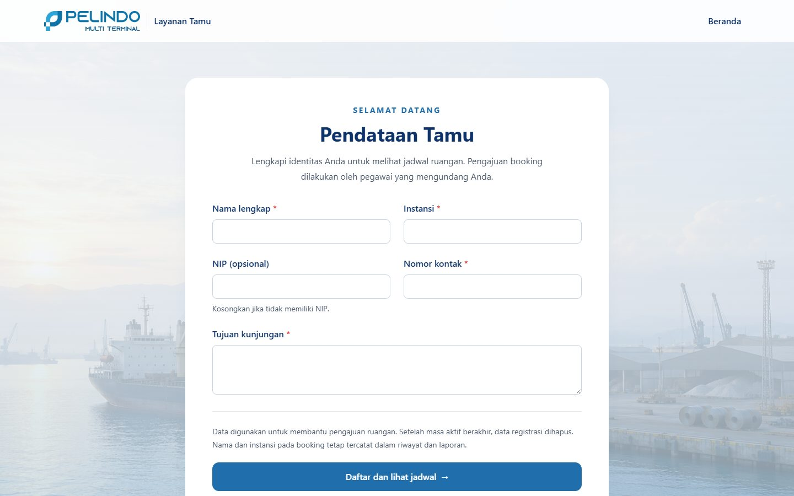 |

| Dashboard Pegawai | Booking Ruangan |
| --- | --- |
| 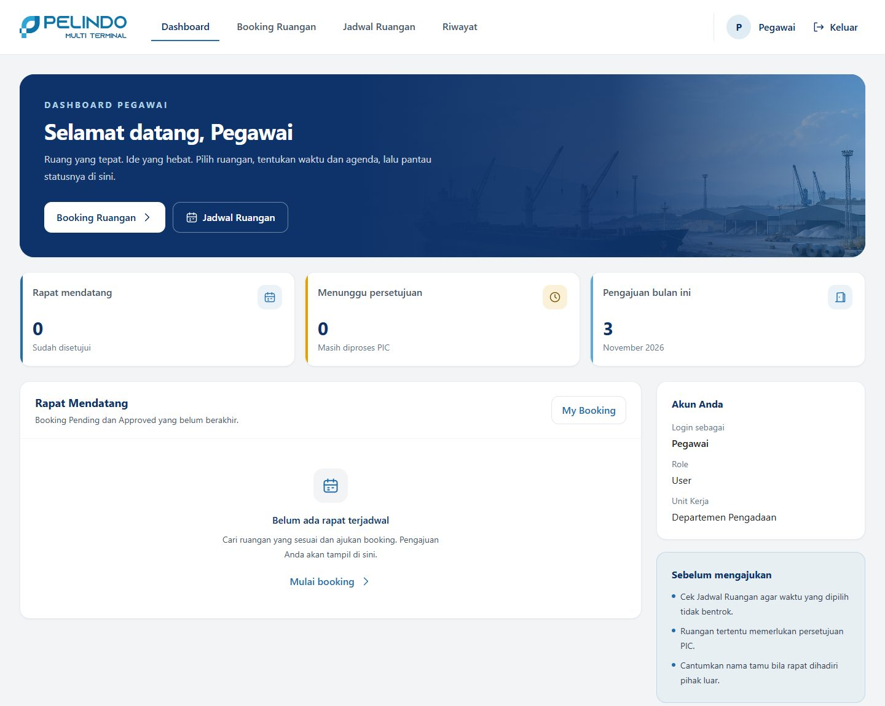 | 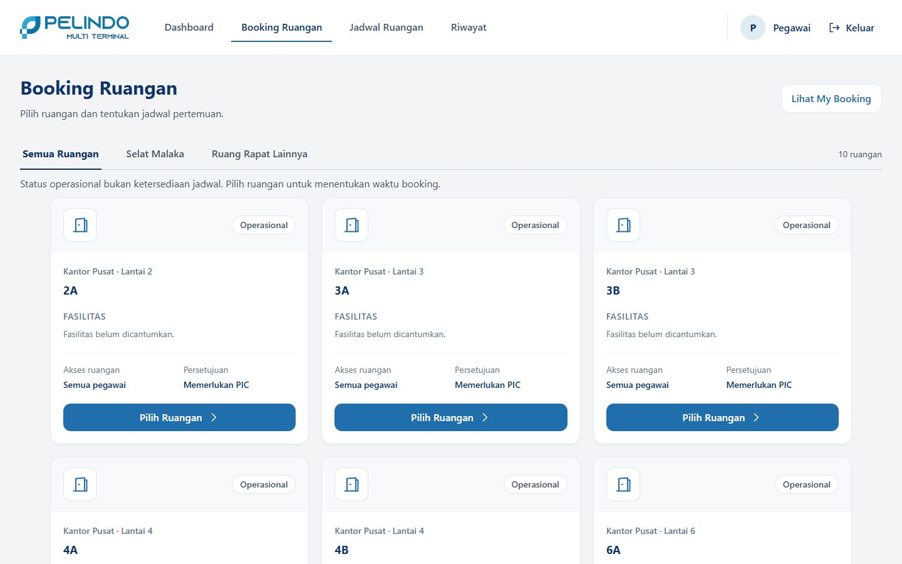 |

| Jadwal Ruangan | Dashboard PIC |
| --- | --- |
| 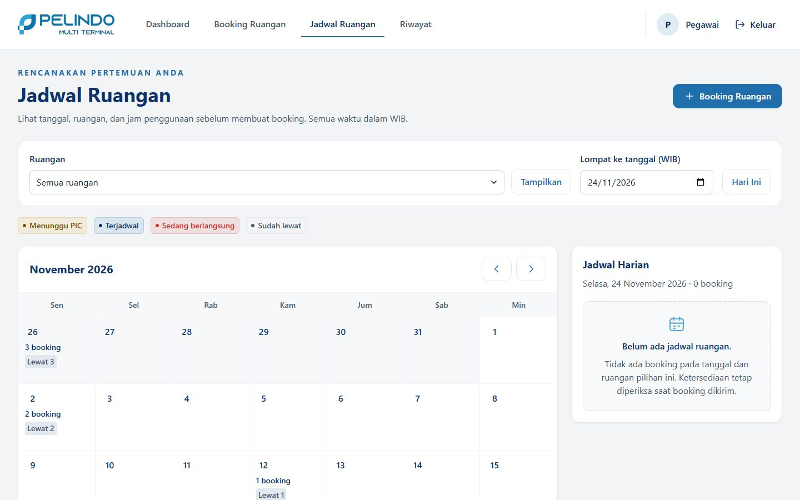 | 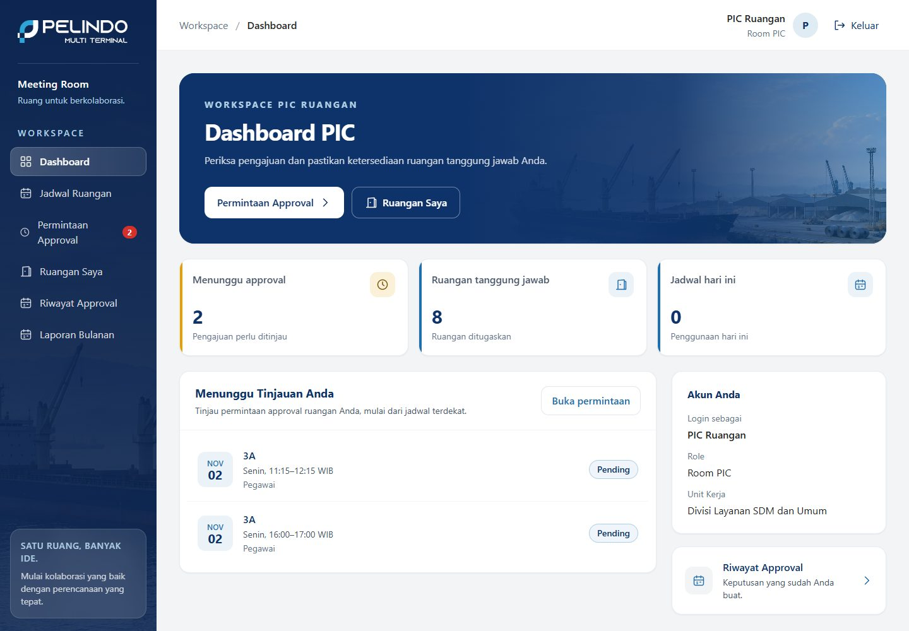 |

| Permintaan Approval (PIC) |
| --- |
| 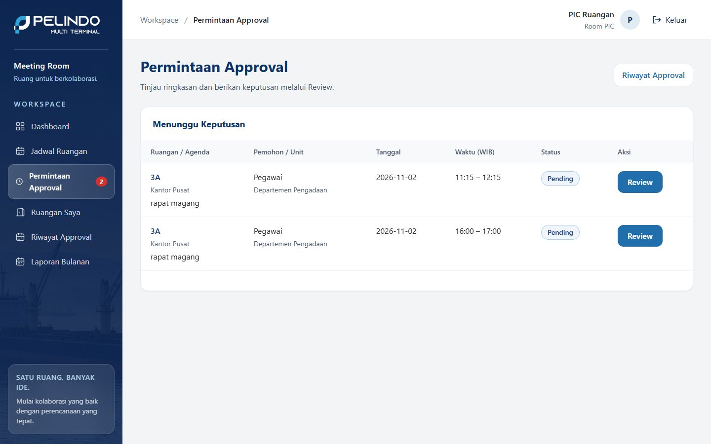 |

*Tangkapan layar diambil dari data pengembangan, bukan data produksi.*

## Peran dan hak akses

| Peran | Nilai `role` | Bisa melakukan |
| --- | --- | --- |
| Pegawai | `user` | Melihat jadwal dan katalog, mengajukan booking, memantau My Booking. |
| PIC Ruangan | `room_pic` | Semua akses pegawai, ditambah meninjau approval ruangan yang ditugaskan, riwayat approval, dan laporan ruangannya. |
| Admin | `admin` | Mengelola satu kantor/cabang: ruangan, PIC, akses unit, akun User/PIC, booking, approval, jadwal, dan laporan di lokasinya. |
| Super Admin | `super_admin` | Semua lokasi, ditambah master data global: cabang, lantai, fasilitas, unit organisasi, dan WhatsApp. |

Akses diatur oleh Gate di `AuthServiceProvider` (`access-general`, `access-employee`, `access-pic`, `access-admin`, `access-super-admin`, `manage-room`, `manage-user`). Batas lokasi diterapkan pada query melalui `Room::visibleTo()` dan `User::canAccessBranch()`, bukan hanya dengan menyembunyikan menu.

## Alur aplikasi

### Alur booking

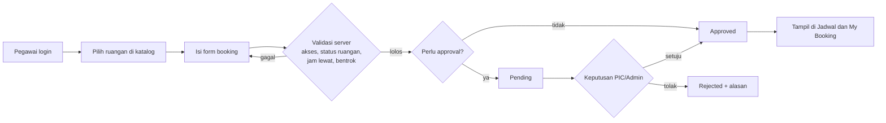

### Status booking

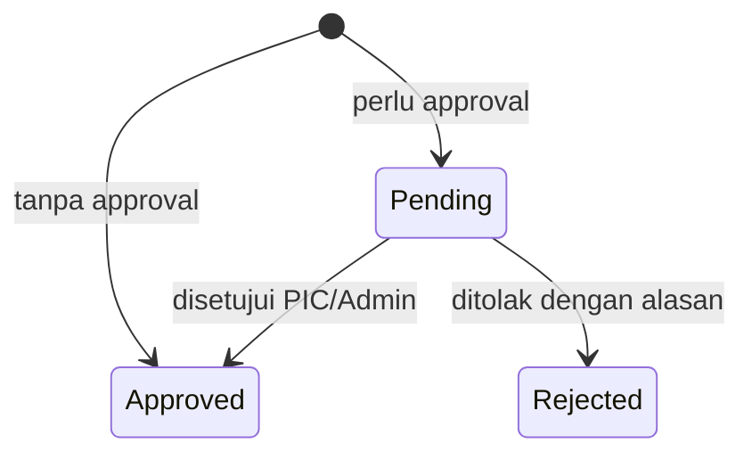

Pending dan Approved menahan slot waktu; Rejected tidak. Skema juga mengenal status Cancelled dan Completed (dibaca oleh jadwal dan laporan), tetapi aplikasi belum menyediakan aksi untuk mengubah booking ke status tersebut.

### Navigasi per peran

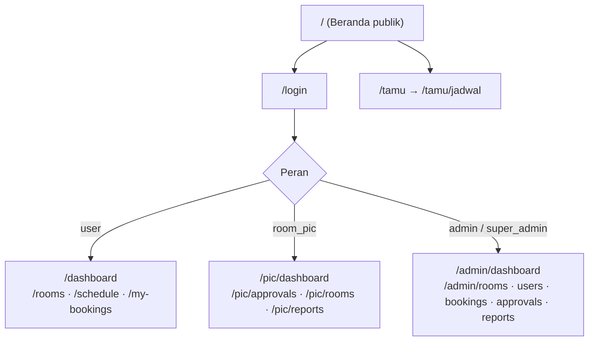

## Arsitektur

Aplikasi monolit Laravel dengan server-side rendering (Blade) dan komponen interaktif Livewire.

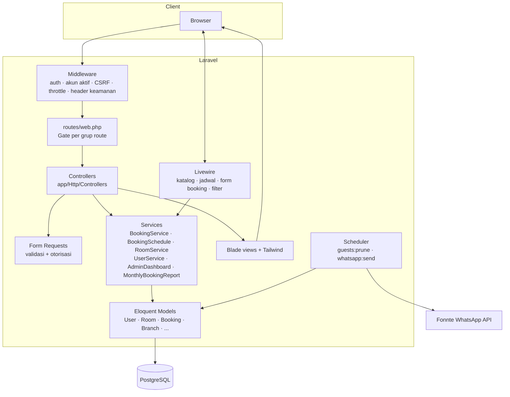

### Struktur folder penting

```text
app/
├── Http/Controllers/        Controller tipis: Admin/, Pic/, Auth/, dan halaman umum
├── Http/Requests/           Validasi dan otorisasi input (FormRequest)
├── Http/Middleware/         Akun aktif, validasi ID route, header keamanan
├── Livewire/                RoomCatalog, RoomSchedule, BookingPreparationForm, ListingFilters
├── Services/                Logika bisnis: booking, jadwal, ruangan, user, laporan, WhatsApp
├── Models/                  Eloquent model dan scope akses (visibleTo)
└── Providers/               Gate (AuthServiceProvider) dan view composer
resources/views/
├── layouts/                 app (satu-satunya <head>), public, visitor, employee, workspace, panel, report
├── components/              Komponen Blade bersama (dashboard-hero, stat-card, workspace-panel, ...)
├── shared/                  Partial lintas peran (jadwal, footer, detail booking)
└── admin/ pic/ user/ guests/ auth/
database/migrations/         Skema PostgreSQL (dengan constraint CHECK untuk integritas)
tests/Feature/               Test fitur pada schema PostgreSQL sementara
docs/                        Konteks, roadmap, progress, keputusan (DEC-xxx), panduan
```

### Layout

`layouts/app` adalah satu-satunya file yang berisi `<html>`/`<head>`. Halaman PIC/Admin memakai `layouts.workspace` (sidebar), pegawai memakai `layouts.employee` (navbar atas), halaman lintas peran memakai `layouts.panel` yang memilih otomatis, sedangkan beranda dan tamu memakai `layouts.public` dan `layouts.visitor`. Semua layout berbagi satu footer (`shared/footer`).

## Keamanan

- **Autentikasi:** session Laravel. Login dibatasi 5 percobaan per kombinasi email+IP, session diregenerasi saat login, dan logout menginvalidasi session serta token CSRF.
- **Otorisasi berlapis:** Gate pada grup route, `authorize()` di FormRequest, cek per record (`manage-room`, `manage-user`), dan scope query per lokasi. Akun nonaktif ditolak oleh middleware.
- **Validasi input:** semua input melalui FormRequest; parameter route divalidasi polanya; properti Livewire penting dikunci (`#[Locked]`) dan diotorisasi ulang di setiap aksi.
- **Output:** Blade meng-escape output secara default. Ekspor CSV menetralkan sel yang diawali `=`, `+`, `-`, `@`, atau karakter kontrol.
- **Header HTTP:** `X-Frame-Options`, `X-Content-Type-Options`, `Referrer-Policy`, `Permissions-Policy`, `Cross-Origin-Opener-Policy`, dan HSTS pada koneksi HTTPS (middleware `SecurityHeaders`).
- **Data tamu:** halaman tamu dikirim dengan `Cache-Control: no-store`, registrasi dibatasi 10 permintaan/menit, dan data dihapus otomatis setelah masa aktif.

Untuk produksi, gunakan `APP_ENV=production`, `APP_DEBUG=false`, HTTPS, dan `SESSION_SECURE_COOKIE=true`.

## Tech stack

| Bagian | Teknologi |
| --- | --- |
| Backend | PHP 8.1+, Laravel 10 |
| UI | Blade, Livewire 3, Tailwind CSS 3 |
| Build aset | Vite 4, Node.js dan npm |
| Database | PostgreSQL |
| Integrasi | Fonnte (WhatsApp), opsional |

Zona waktu booking adalah WIB (`config/booking.php`).

## Menjalankan secara lokal

Persyaratan: PHP 8.1+ dengan `pdo_pgsql`, Composer, Node.js + npm, dan PostgreSQL dengan database kosong.

```bash
composer install
npm install
cp .env.example .env          # PowerShell: Copy-Item .env.example .env
php artisan key:generate
```

Atur `DB_HOST`, `DB_PORT`, `DB_DATABASE`, `DB_USERNAME`, dan `DB_PASSWORD` di `.env`, lalu:

```bash
php artisan migrate --seed
npm run build
php artisan serve
```

Buka <http://127.0.0.1:8000>. Untuk hot reload frontend, jalankan `npm run dev` di terminal kedua.

Seeder menyiapkan data fondasi dan contoh ruangan untuk pengembangan. Jangan gunakan data seed sebagai data produksi; buat akun produksi melalui prosedur provisioning yang berlaku.

## Pengujian

Test fitur memakai `Tests\PostgresTestCase`, yang membuat schema sementara di database dari `.env`, menjalankan migrasi dan seeder fondasi, lalu menghapus schema tersebut.

```bash
APP_ENV=testing php artisan test                         # semua test
APP_ENV=testing php artisan test --filter=BookingWorkflowTest
```

Jika shell mengekspor `APP_ENV=local` dari `.env`, set `APP_ENV=testing` secara eksplisit seperti di atas.

## Konfigurasi opsional

### WhatsApp melalui Fonnte

Integrasi nonaktif secara default. Atur `WHATSAPP_ENABLED=true` dan `FONNTE_TOKEN` di `.env`, lalu konfigurasi penerima dan template di halaman Admin. Pengiriman membutuhkan scheduler:

```bash
php artisan schedule:work      # pengembangan
php artisan whatsapp:status    # cek status
```

Di server produksi, daftarkan cron Laravel Scheduler. Simpan token sebagai rahasia dan jangan commit `.env`.

### Pendataan tamu

Atur `GUEST_EXPIRY_MODE` dan `GUEST_ACTIVE_DAYS` untuk masa aktif. `GUEST_BRANCH_ID` menentukan lokasi resepsionis; bila kosong, lokasi pertama dari master data dipakai. Penghapusan data kedaluwarsa dijalankan scheduler (`guests:prune`).

## Perintah pengembangan

```bash
npm run dev              # Vite dengan hot reload
npm run build            # build aset produksi
php artisan route:list   # daftar route
vendor/bin/pint --dirty  # format kode PHP
```

## Dokumentasi

- [Konteks dan cakupan proyek](docs/PROJECT_CONTEXT.md)
- [Roadmap](docs/ROADMAP.md)
- [Progress pengembangan](docs/PROGRESS.md)
- [Keputusan proyek (DEC-xxx)](docs/DECISIONS.md)
- [Panduan frontend](docs/FRONTEND_GUIDE.md)
- [Autentikasi](docs/AUTHENTICATION.md) dan [Otorisasi](docs/AUTHORIZATION.md)
- [Skema database](docs/DATABASE.md)
- [Panduan WhatsApp](docs/WHATSAPP.md)
- [Panduan pendataan tamu](docs/GUESTS.md)

## Lisensi dan penggunaan

Aplikasi ini dibuat untuk kebutuhan internal PT Pelindo Multi Terminal. Pastikan Anda memiliki izin dan mengikuti kebijakan organisasi sebelum menggunakan atau mendistribusikan kode maupun data. Lisensi framework Laravel tidak otomatis menjadi lisensi repository ini.
